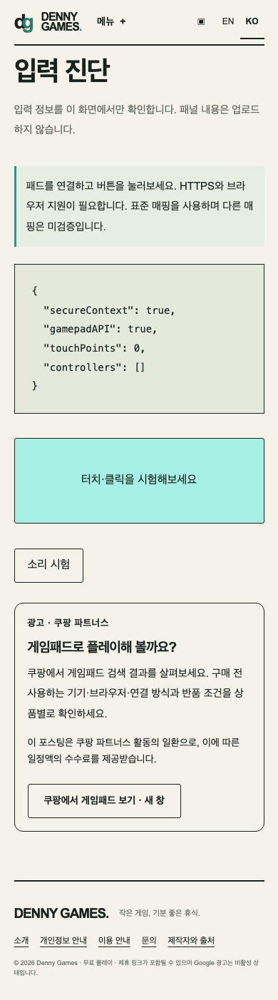
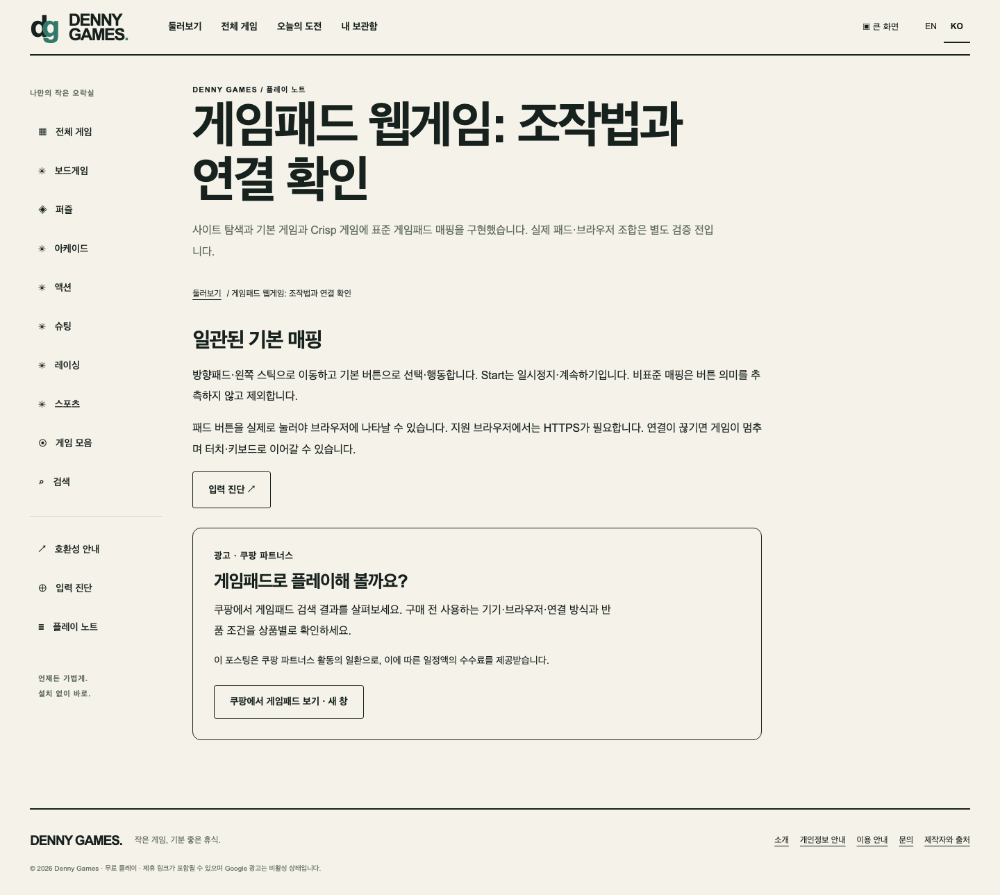

# Korean controller affiliate path — 2026-10-14

## Change

- Add the existing static Coupang gamepad-search card to `/ko/gamepad-test/`, `/ko/controller-games/` and `/ko/guides/controller-not-detected/`.
- Keep the link absent from English controller pages and from gameplay, search and library routes.
- Add nearby advice to check device/browser compatibility, connection type and return terms before buying. No individual product or compatibility is endorsed.
- Keep the advertisement label, commission disclosure, `sponsored` relationship and click-only external navigation. No analytics or Coupang resources load on page open.

## Verification

- `npm run verify` passed: Astro/TypeScript, 64 unit tests, docs checks, scale fixture and 894-route static build.
- `PLAYWRIGHT_PORT=45432 npm run test:e2e` passed all 450 Chromium browser tests, including Korean-only placement and 320/390/430px overflow checks.
- The issued link returned an HTTP redirect to Coupang gamepad search with affiliate tracking fields. A command-line follow-up was blocked by Coupang's edge response; product availability and a completed purchase were not verified.

## Screenshots

- Mobile gamepad diagnostic: 
- Desktop controller guide: 

## Revenue evidence

The change improves the purchase path but does not establish clicks, orders, settlement or revenue. No analytics provider was added. AdSense remains in verification mode; approval, certified consent, live ad serving and revenue remain separate pending evidence.
