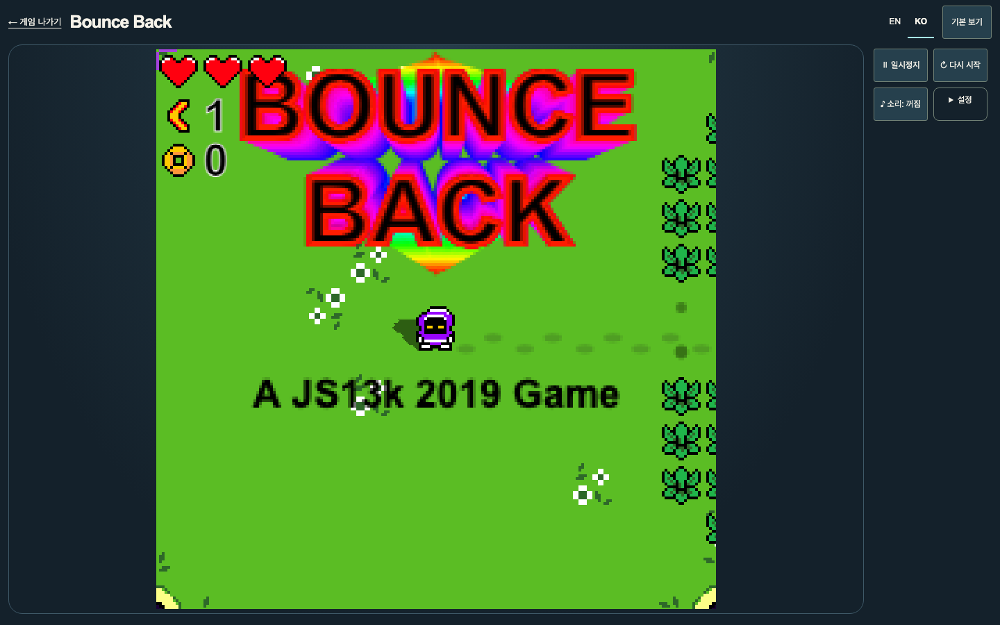

# Bounce Back — 2026-10-14

## Change

- Add Bounce Back as the 200th playable title and highlight its procedural action roguelite mechanics in the editorial catalog and point-and-play collection.
- Pin upstream commit 395fd046338e6c5d5840d10e7fbd74132f90b8f6. Retain hashes for the game, engine, debug source, tile sprite, screenshot, README, HTML and complete GPL-2.0-or-later license.
- Serve the adapted game in an opaque-origin sandbox with no network or same-origin privileges. Keep the eval-based debug console out of the runtime while retaining its source.
- Add bilingual keyboard/mouse, split-touch and standard gamepad instructions. Keep gems and unlocks in this browser; leaving a run restarts its active rooms.
- Connect pause/resume, mute and volume to the common player. Add an automated journey for the sandbox, input, save, sound and lifecycle.

## Verification

`npm run verify` passed with 64 unit tests, the 1,000-game scale fixture, 898 generated routes, artifact audits and SEO checks. The full Chromium suite passed 452 tests; the updated Bounce Back detail/play journey also passed its targeted run. Formatting and documentation checks passed. Security and quality reviews found no P0/P1 issues. PR CI and public merge-SHA/URL readback remain separate release gates.

Automated browser checks do not establish a full game campaign, subjective fun, physical-device support or revenue.

## Browser evidence

Captured from the Korean play route in Chromium after the game had advanced beyond its title sequence. This demonstrates the rendered game and player controls; it is not a full campaign or physical-device check.

