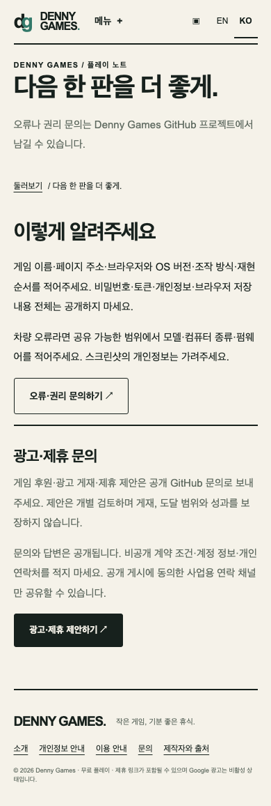
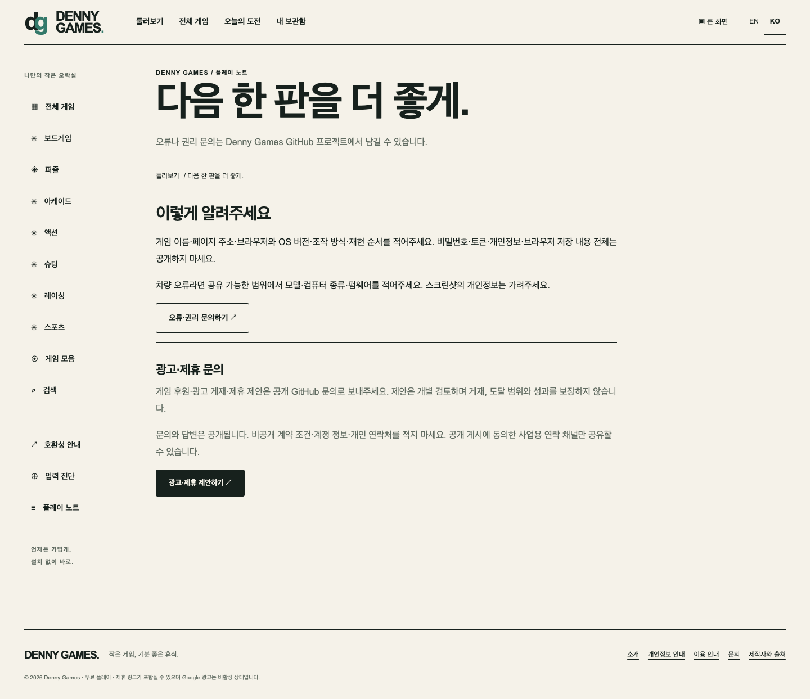

# Public partnership inquiry — 2026-10-14

## Change

- Add an advertising and partnership section to the English and Korean contact pages.
- Link to a structured public GitHub issue form for game sponsorship, ad placement and affiliate proposals.
- State that issues and replies are public; allow only optional public business contact details and reject confidential information.
- Do not claim traffic, audience reach, placement guarantees, rates or campaign performance.
- Update the privacy page, advertising guide, PRD and ADR 0023.

## Verification

- `npm run verify` passed: 64 unit tests, documentation checks, 1,000-game scale fixture and 894-page static build.
- `PLAYWRIGHT_PORT=45432 npm run test:e2e` passed all 451 Chromium tests, including public-inquiry copy and link checks in both locales.
- The GitHub issue form YAML parsed locally. GitHub serves repository issue forms from the default branch, so the rendered template will be checked after merge.
- The screenshots below are local static-preview captures; they do not imply traffic or conversion.

## Screenshots

- Korean mobile contact page: 
- Korean desktop contact page: 

## Revenue evidence

The form creates an inquiry path only. Sponsor demand, agreement, placement, traffic and revenue are not established.
