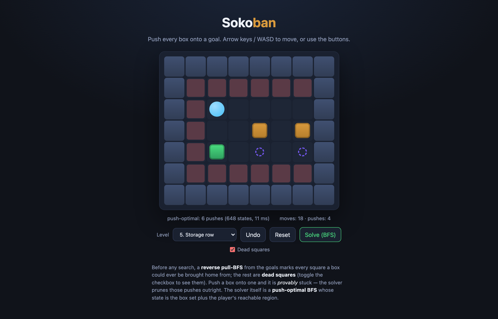

# sokoban

**Sokoban** with two real algorithms inside: a **push-optimal BFS solver**, and
provable deadlock detection — a **reverse pull-BFS** from the goals marks every
*dead square* before the search even starts (toggle the overlay in the demo to
see them). TypeScript, no runtime dependencies.



**Live demo:** https://sen.ltd/portfolio/sokoban/

## Run

```sh
npm install
npm run dev      # http://localhost:5173
npm test         # 17 vitest cases (all levels solver-verified)
npm run build    # production build to dist/
```

Arrow keys / WASD to move; Undo, Reset, level select, and *Solve (BFS)* which
animates a push-optimal solution **from the current position**.

## Dead squares: thinking backward

Forward reasoning asks "where can this box go?" — expensive. The trick is to
reason **backward**: a box can reach a goal iff the goal can be reached by
*pulling* the box, and pulls have no deadlocks. So one BFS from every goal,
expanding by legal pulls, marks every *alive* square:

```ts
// a pull from `from` to `to` needs the player beyond `to`
const to = from + d;
const playerSq = to + d;
if (walls[to] || walls[playerSq]) continue;   // otherwise `to` is pull-reachable
```

Everything unmarked is a **dead square**: push a box there and the level is
*provably* lost — no search needed. Non-goal corners fall out automatically, and
so do entire wall-hugging edges with no goal on them (a case explicitly pinned
by a test). The solver prunes any push onto a dead square outright.

## The solver: push-optimal BFS over (region, boxes)

Between pushes the player just walks, so player position doesn't matter — only
which *region* of the board the player can reach. A search state is the box set
plus the player's reachable region, canonicalized to the region's smallest cell:

```ts
const k = canon + ':' + boxes.join(',');   // state key: region + box set
```

Transitions are single box pushes (player must reach the cell behind the box).
BFS depth is then the number of pushes, so the first solution found is
**push-optimal**. The status line reports pushes, states explored, and time.

Because `solve` runs from the *current* position, pushing a box into a corner
and hitting Solve answers "provably unsolvable from here — try Undo": the search
space is exhausted, not timed out, so it's a proof, not a guess.

For animation, each push is expanded into player steps with a per-push BFS walk
(`expandSolution`), and a test replays those steps through the movement rules to
confirm they're all legal and end in a win.

## Levels are solver-verified

The six bundled mini-levels are original. The test suite requires the solver to
solve **every** bundled level and replay-verify the result — while writing them,
this caught a level where boxes sat against the right wall with no way to ever
push them left: genuinely impossible, flagged by the suite, redesigned. Ship
your levels through your solver.

```
src/sokoban.ts      — pure engine: parser, movement, pull-BFS dead squares,
                      push-optimal BFS, walk pathing, solution expansion
src/sokoban.test.ts — 17 cases (rules, dead squares, solver proofs, replays)
src/levels.ts       — 6 original levels, all solver-verified
src/main.ts         — DOM shell: grid, input, undo, animated solve, dead overlay
```

## License

MIT

<!-- sen-publish:links -->
## Links

- 🌐 Demo: https://sen.ltd/portfolio/sokoban/
- 📝 記事: https://qiita.com/sen-ltd/items/b48bdf0a0079e77c8c8f
- 📝 dev.to: https://dev.to/sendotltd/solving-sokoban-backward-provable-dead-squares-via-pull-bfs-and-a-push-optimal-bfs-solver-3bi1
<!-- /sen-publish:links -->
